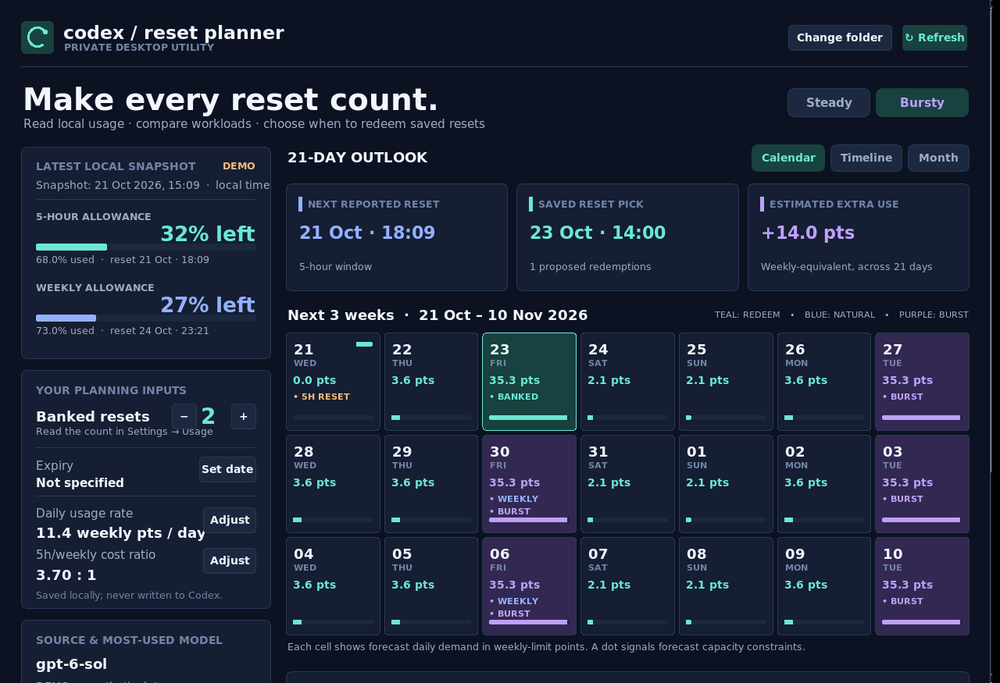

AI One-Shotted this from a prompt.

Useful calender calculator for optimising your usage resets against your actual usage dynamics. 

# Codex Reset Planner

**A tiny, fully offline desktop calendar for planning Codex allowance resets.**

Codex Reset Planner reads **local Codex CLI session metadata**, displays your last-observed five-hour and weekly allowance percentages, and estimates when a saved reset might be most useful. Compare a regular **Steady** schedule with concentrated **Bursty** workloads in a calendar, timeline, or month view.

> **Independent project.** Not affiliated with or endorsed by OpenAI. Plans are estimates, not official usage measurements or guarantees. The app **never redeems resets**.



*Screenshot uses explicitly labeled **synthetic demo data**. No account data is included in this repository.*

## Quick start

**Requirements:** Python **3.10+** with **Tkinter** support. No pip installs, internet connection, OpenAI API key, sign-in, or external Python packages are required. This ZIP contains a launchable **source-based desktop app**, not a bundled `.exe` or `.app` binary.

1. Download the project ZIP and **extract** it.
2. Start the app using the launcher for your OS:

   | OS | What to run |
   | --- | --- |
   | Windows | Double-click **`Run on Windows.bat`**. You can also double-click `Codex Reset Planner.pyw` if Python is associated with `.pyw` files. |
   | macOS | Double-click **`Run on macOS.command`**. If macOS blocks it, use the file's context menu to choose **Open**. |
   | Linux | Run **`Run on Linux.sh`** (or `sh "Run on Linux.sh"`). You may need your distribution's `python3-tk` package. |

   Or launch from a terminal inside the folder:

   ```bash
   python3 app.py
   ```

3. The app automatically looks under **`~/.codex`**, or **`$CODEX_HOME`** if defined. Use **Change folder** to pick a different Codex directory.
4. If you have saved/banked resets, enter their **count** and any **expiry date** manually. Check your account's **Settings → Usage** for the real number and terms. The session logs do not reliably include this information.
5. Compare **Steady** vs **Bursty** usage, choose **Calendar**, **Timeline**, or **Month**, and click a day to review the forecast. Use **Refresh** to rescan local logs.

If there are no usable local rate-limit samples, select **Preview with sample data** in the app. This is clearly marked as a demo, not your quota.

## Guide: reading the planner

| Display | Meaning |
| --- | --- |
| **5-hour allowance** | Remaining percentage from the most recent *local* Codex session snapshot. |
| **Weekly allowance** | Remaining weekly percentage from the latest usable local snapshot. |
| **Next reported reset** | Timestamp observed in a log, not a live check of your account. |
| **Saved reset pick** | Suggested **manual** redemption time, if the forecast predicts a worthwhile benefit. |
| **Estimated extra use** | Predicted additional work that could fit into the allowance, expressed in **weekly-equivalent percentage points**; not API tokens or money. |
| **Daily rate / 5h-to-weekly ratio** | Inferred from eligible historical changes when possible; otherwise adjustable assumptions. |

**Calendar colors** identify proposed saved-reset days, ordinary allowance windows, and scheduled bursts. Use **Timeline** for a chronological event list and **Month** for a broader view. The calendar is a **21-day forecast**, not an automatically created OS calendar event.

### How to use a recommended reset

1. Confirm that a saved reset is **actually available**, eligible for your account, and has the expected effects or expiry.
2. Review the suggested date in the app's forecast.
3. If you decide to use it, redeem it **yourself** through the account's supported interface. **The app cannot redeem anything.**
4. Click **Refresh** afterward to read any newly written local snapshots.

**Steady** distributes work over regular weekday hours; **Bursty** concentrates work into larger blocks on two weekdays. Switch modes to see how optimal *estimated* reset timing changes. If your actual schedule differs, adjust the **daily usage rate** and **5h/weekly cost ratio** in the app.

## Offline by design

- **Read-only source:** Recent `*.jsonl` records from `<codex>/sessions` and `<codex>/archived_sessions`; specifically `event_msg` → `token_count` → `rate_limits`, and model labels from `turn_context`.
- **Never reads:** `auth.json`, prompts, message bodies, source files, or credentials as application data. It does not send log content anywhere.
- **Does not run:** Codex CLI, model inference, HTTP calls, background services, analytics, or reset redemption.
- **Own preferences only:** `~/.codex-reset-planner/settings.json` (not inside the Codex folder). It does not write to the Codex session logs.
- **Bounded scan:** Up to 280 recent session files and 150 MB combined read budget.

The **application** runs without an internet connection. Publishing the project to GitHub is a **separate, manual online step**.

## What the forecast can and cannot do

The planner takes recent allowance percentages and timestamps, estimates daily usage and the relative five-hour/weekly costs, and simulates demand in one-hour increments. A bounded beam-search compares possible saved-reset dates over 21 days, accounting for the possibility that a saved reset changes the subsequent weekly reset schedule. It favors greater estimated usable allowance and penalizes wasting unused allowance.

It is a **heuristic**, not a proof of mathematical optimality. Session snapshots may be stale, missing, or use a different schema; some usage may happen outside the logs. A fallback daily rate of **12 weekly percentage points/day** and conversion ratio of **4:1** can be edited. Model advice is qualitative: official per-model allowance costs cannot be reconstructed accurately from these local records.

The planner does **not** claim to know how many saved resets you have, whether your plan permits them, or whether a suggested redemption will work. Verify with your account before acting.

## Troubleshooting

| Problem | Try this |
| --- | --- |
| Nothing happens when starting | Check Python: `python3 --version` (or `py -3 --version` on Windows). Ensure Python is 3.10+ and Tkinter is installed. |
| `No module named tkinter` | Install the operating system's Tkinter support package or a Python build that includes Tk. |
| `No usable local rate-limit snapshots` | Confirm Codex CLI has generated session logs. Check **Change folder** and `$CODEX_HOME`. Use **Preview with sample data** to inspect the UI. |
| Figures look old | Refresh the app. It only has the snapshots previously written on disk; it never asks the account service for new figures. |
| Reset count is wrong | The count is manual: edit it using the saved-reset controls after checking your account. |
| macOS launcher cannot be opened | From a terminal, try `sh "Run on macOS.command"` (from the extracted folder). |

## Project layout

```text
codex-reset-planner/
├── app.py                     # Tkinter UI and launch entry point
├── core.py                    # Read-only metadata scanner and forecast
├── assets/
│   ├── preview.png            # Synthetic demo screenshot shown above
│   ├── icon.png
│   └── icon.ico
├── tests/test_core.py         # Standard-library unit tests
├── .github/workflows/tests.yml
├── Run on Windows.bat
├── Run on macOS.command
├── Run on Linux.sh
├── Codex Reset Planner.pyw
└── README.md
```

### Running tests

```bash
python3 -m unittest discover -s tests -v
```

Tests use synthetic data and temporary files; no Codex installation or account is needed. A GitHub Actions workflow runs the tests on pushes and pull requests.

## Publish this project as a public GitHub repository

**The downloaded ZIP is an initialized local Git repository with an initial commit, but it has not been published to a GitHub account.** Publication requires your own GitHub account and an authenticated upload.

**Fastest route (GitHub CLI + Git installed):**

1. Extract the ZIP and open a terminal in the `codex-reset-planner` folder.
2. Authenticate with your GitHub account (once):

   ```bash
   gh auth login
   ```

3. Create the public repository and push the initial commit:

   ```bash
   gh repo create codex-reset-planner --public --source=. --remote=origin --push
   ```

4. Visit the repository URL printed by `gh`. GitHub will render this README and the screenshot automatically.

**Without GitHub CLI:** Create an empty **public** repository named `codex-reset-planner` on GitHub **without** adding a README or .gitignore (those are already here), then from this folder run:

```bash
git remote add origin https://github.com/YOUR-USERNAME/codex-reset-planner.git
git push -u origin main
```

Replace `YOUR-USERNAME` with your account name and authenticate when prompted. If Git asks for an author identity for later commits, set your own `user.name` and `user.email`. The packaged starter commit uses a clearly generic local build identity; you can amend it with your own identity before publishing if desired.

**Privacy check:** The ZIP ships with synthetic example data only, plus a `.gitignore` that excludes Codex session logs, authentication files, and local settings. Do not add your real `.codex` folder or personal usage exports to the public repository.

## License

No license or activation is required to **run the application**. This repository ZIP does not include a redistribution license; if you plan to invite third-party reuse or contributions, choose an open-source license before publishing.
